> 本文是数据结构课程设计的配套学习讲解，随正式提交版代码一同留档。代码片段用于说明思路，实际行为以仓库源码为准。文末的扩展方向仅为设想，目前不实施。项目介绍及运行方法见 [README](README.md)。

# 第1章 系统分析与设计

## 1.1 系统需求分析

随着高校图书馆馆藏资源的日益丰富和读者人数的持续增长，传统的人工登记、纸质台账管理模式已无法满足高效、准确的管理需求。本系统旨在为图书馆提供一个**数字化、自动化的图书借阅管理平台**，实现对图书资料、读者信息和借阅记录的统一管理和实时监控。

本系统以控制台交互方式运行，面向图书馆管理员使用，主要解决以下核心需求：

1. **图书资料管理需求**：图书馆需要对馆藏图书进行分类管理（书籍、期刊、报刊），支持图书信息的增删改查以及出入库操作，确保库存信息准确。
2. **读者管理需求**：需要对读者进行分类管理（教师、学生），支持读者信息的录入、修改、查询，以及挂失/注销（封禁/解封）等操作。不同身份的读者享有不同的借阅权限。
3. **借阅管理需求**：需要支持借书、还书、续借三大核心业务。还书时自动计算超期罚款，累计罚款达到上限时自动封禁读者。当图书库存为零时，读者可预约排队。
4. **统计分析需求**：管理员需要随时了解当前借阅情况，包括借阅排行榜、库存统计、超期统计和当前借阅统计，为图书采购和管理决策提供数据支撑。

### 系统功能概述

本系统是一款**基于C++控制台的图书管理系统**，采用四层架构（表示层→业务逻辑层→数据访问层→数据模型层）设计。系统通过控制台菜单与用户交互，数据以管道符分隔的文本文件持久化存储。

**主要功能模块**包括：
- **图书管理**：新增、删除、修改、查找、显示全部、入库、出库
- **读者管理**：新增、删除、修改、查找、显示全部、封禁、解除封禁
- **借阅管理**：借书、还书、续借、预约图书、取消预约、查看预约队列
- **统计分析**：借阅排行榜、库存统计、超期统计、当前借阅统计

## 1.2 系统功能设计

### 总体功能结构图

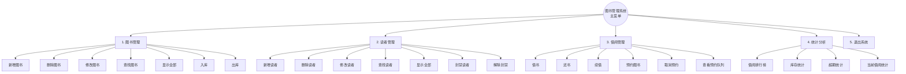

本系统采用**经典四层架构**设计，各层职责分明：

| 层级 | 职责 | 实现类 |
|------|------|--------|
| 表示层（UI） | 菜单显示、用户输入获取、调用业务层 | `main.cpp` |
| 业务逻辑层 | 数据校验、业务规则判断、流程编排 | `BookManager`、`ReaderManager`、`LoanManager`、`StatisticsManager`、`ReservationManager` |
| 数据访问层 | 内存数据CRUD、数据结构维护 | `BookRepository`、`ReaderRepository`、`LoanRepository`、`ReservationRepository` |
| 数据模型层 | 纯数据容器，定义字段和构造方法 | `Book`、`Reader`、`Loan`、`Reservation` |
| 工具层 | 通用算法与辅助功能 | `BST`、`SortAlgorithms`、`DateUtils`、`DataManager` |

### 1.2.1 图书管理模块设计

图书管理模块负责图书馆馆藏资料的维护，支持按类别（书籍、期刊、报刊）分类管理。

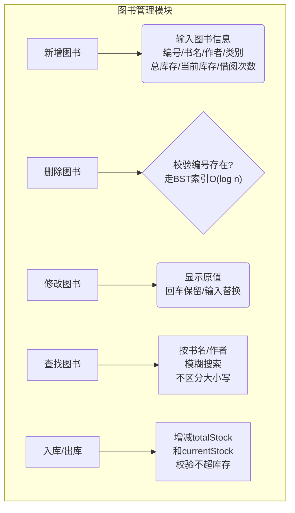

**主要功能：**

| 功能 | 描述 | 关键校验规则 |
|------|------|-------------|
| 新增图书 | 输入图书信息并保存 | bookId不为空且不重复，类别须为"书籍/期刊/报刊"，库存≥0 |
| 删除图书 | 按编号删除图书记录 | 编号必须存在 |
| 修改图书 | 按编号修改图书信息 | 编号存在，新信息通过校验（支持保留原值） |
| 查找图书 | 按书名或作者关键字模糊搜索 | 不区分大小写，匹配即返回 |
| 显示全部 | 列表展示所有图书信息 | — |
| 入库 | 增加总库存和当前库存 | 数量>0，编号存在 |
| 出库 | 减少总库存和当前库存 | 数量>0，编号存在，减少后库存≥0 |

### 1.2.2 读者管理模块设计

读者管理模块负责读者信息的维护，支持按身份（学生/教师）分类管理，不同身份享有不同借阅权限。

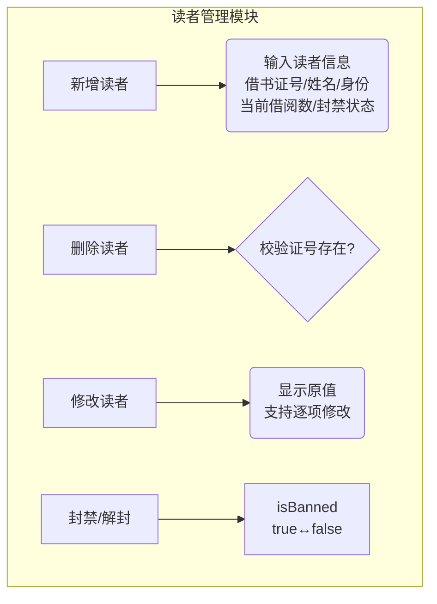

**主要功能：**

| 功能 | 描述 | 关键校验规则 |
|------|------|-------------|
| 新增读者 | 输入读者信息并保存 | cardId不为空且不重复，身份须为"学生"或"教师" |
| 删除读者 | 按借书证号删除读者 | 证号必须存在 |
| 修改读者 | 按证号修改读者信息 | 证号存在，新信息通过校验 |
| 查找读者 | 按借书证号精确查找 | 线性遍历（读者数量小，O(n)足够） |
| 显示全部 | 列表展示所有读者信息 | — |
| 封禁读者 | 将读者标记为封禁状态 | 封禁后不可借书和预约 |
| 解除封禁 | 恢复读者正常状态 | — |

**读者身份与借阅权限：**

| 身份 | 最大借阅数 |
|------|-----------|
| 学生 | 3 本 |
| 教师 | 5 本 |

### 1.2.3 借阅管理模块设计

借阅管理模块是本系统的**核心模块**，负责借书、还书、续借三大业务以及预约功能。

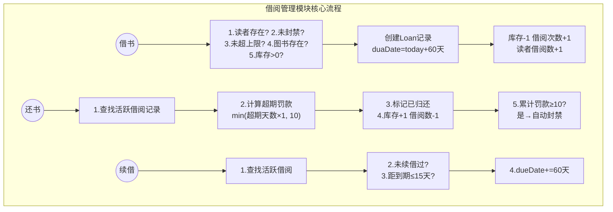

**主要功能：**

| 功能 | 描述 | 业务规则 |
|------|------|---------|
| 借书 | 读者借阅一本图书 | 9步流水线校验：读者存在→未封禁→未超上限→图书存在→库存足够→创建记录→减库存→增借阅次数→增读者借阅数 |
| 还书 | 读者归还已借图书 | 6步流程：查活跃记录→计算罚款→标记归还→恢复库存→减借阅数→自动封禁检查 |
| 续借 | 延长借阅期限 | 限一次，须在到期前15天内操作，续借延长60天 |
| 预约图书 | 库存为0时排队预约 | 7步校验：读者存在→未封禁→图书存在→库存=0→未借阅此书→未预约过→加入FIFO队列 |
| 取消预约 | 主动取消已提交的预约 | 从对应图书的deque中删除 |
| 查看预约队列 | 查看某书或全部的预约排队情况 | 按FIFO顺序展示 |

**系统业务参数：**

| 参数 | 数值 | 说明 |
|------|------|------|
| 借阅期限 | 60天 | borrowDate + 60 |
| 续借期限 | 60天 | 续借后 dueDate + 60 |
| 续借窗口 | 到期前15天 | 距到期>15天不可续借 |
| 超期罚款 | 1元/天 | 最高10元封顶 |
| 封禁门槛 | 累计罚款≥10元 | 自动封禁 |

### 1.2.4 统计分析模块设计

统计分析模块对系统数据进行**只读汇总与分析**，帮助管理员了解当前借阅状况。

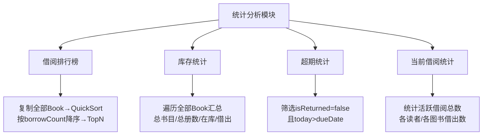

**主要功能：**

| 功能 | 描述 | 实现方式 |
|------|------|---------|
| 借阅排行榜 | 按历史借阅次数排序，支持Top N | 复制vector→QuickSort降序→截取前N |
| 库存统计 | 汇总总书目数、总册数、在库册数、借出册数 | 遍历vector累加totalStock和currentStock |
| 超期统计 | 列出所有已超期未归还的借阅记录 | 遍历list<Loan>筛选isReturned=false且today>dueDate |
| 当前借阅统计 | 统计当前活跃借阅的读者分布和图书分布 | 遍历list<Loan>按cardId和bookId分组计数 |

---

# 第2章 数据结构与算法

> 基于 **图书管理系统** 实际代码，按系统存储的 4 种数据类型分类，从底层数据结构逐步深入到上层业务算法。
> 所有代码片段均来自项目真实 C++ 源码。

---

## 本章目录

- [2.1 BST二叉搜索树索引与QuickSort排序算法（图书数据）](#21-bst二叉搜索树索引与quicksort排序算法图书数据)
  - [2.1.1 Book 数据模型定义](#211-book-数据模型定义)
  - [2.1.2 底层数据结构：vector顺序表](#212-底层数据结构vector顺序表)
  - [2.1.3 BST二叉搜索树核心操作](#213-bst二叉搜索树核心操作)
  - [2.1.4 QuickSort排序算法（Lomuto分区）](#214-quicksort排序算法lomuto分区)
- [2.2 顺序表与线性查找算法（读者数据）](#22-顺序表与线性查找算法读者数据)
  - [2.2.1 Reader 数据模型定义](#221-reader-数据模型定义)
  - [2.2.2 底层数据结构：vector顺序表](#222-底层数据结构vector顺序表)
  - [2.2.3 线性查找算法](#223-线性查找算法)
  - [2.2.4 CRUD 操作流程](#224-crud-操作流程)
- [2.3 双向链表与借阅业务算法（借阅数据）](#23-双向链表与借阅业务算法借阅数据)
  - [2.3.1 Loan 数据模型定义](#231-loan-数据模型定义)
  - [2.3.2 底层数据结构：list双向链表](#232-底层数据结构list双向链表)
  - [2.3.3 borrowBook 借阅流程](#233-borrowbook-借阅流程)
  - [2.3.4 returnBook 归还流程（含罚款与自动封禁）](#234-returnbook-归还流程含罚款与自动封禁)
  - [2.3.5 renewBook 续借流程](#235-renewbook-续借流程)
  - [2.3.6 日期计算算法：绝对天数转换](#236-日期计算算法绝对天数转换)
- [2.4 键值队列与FIFO预约调度算法（预约数据）](#24-键值队列与fifo预约调度算法预约数据)
  - [2.4.1 Reservation 数据模型定义](#241-reservation-数据模型定义)
  - [2.4.2 底层数据结构：map + deque键值队列](#242-底层数据结构map--deque键值队列)
  - [2.4.3 reserveBook 预约流程](#243-reservebook-预约流程)
  - [2.4.4 processReturnedBook 归还触发出队](#244-processreturnedbook-归还触发出队)

---

## 2.1 BST二叉搜索树索引与QuickSort排序算法（图书数据）

**涉及文件：** `include/models/Book.h`, `include/repositories/BookRepository.h/.cpp`, `include/utils/BST.h`, `include/utils/SortAlgorithms.h`

图书是本系统最核心的数据实体，采用 **双结构存储**：用 `std::vector` 存全部图书（支持顺序遍历和排序），用 `BST` 建立图书编号索引（支持 O(log n) 快速查找）。

### 2.1.1 Book 数据模型定义

在深入数据结构之前，先看清 **Book 这个"数据原子"长什么样**。每个 Book 对象包含 7 个字段，全部公有（public），方便 Repository 和 Manager 直接访问。

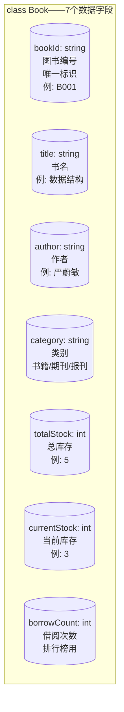

> **来源：** `include/models/Book.h:101-107` —— 数据字段声明

```cpp
class Book {
public:
    std::string bookId;          // 图书编号（唯一标识）
    std::string title;           // 书名
    std::string author;          // 作者
    std::string category;        // 图书类别："书籍" / "期刊" / "报刊"
    int         totalStock;      // 总库存
    int         currentStock;    // 当前库存
    int         borrowCount;     // 借阅次数（排行榜使用）
};
```

#### 构造函数

Book 提供两种构造方式：**默认构造**（所有字段置零/置空）和**全参构造**（一次性初始化全部字段）。

> **来源：** `src/models/Book.cpp:17-44`

```cpp
// 默认构造函数 —— 全部字段初始化为默认值
Book::Book()
    : bookId("")
    , title("")
    , author("")
    , category("")
    , totalStock(0)
    , currentStock(0)
    , borrowCount(0)
{
}

// 带参构造函数 —— 直接初始化全部 7 个字段
Book::Book(const std::string& id, const std::string& t,
           const std::string& a, const std::string& cat,
           int total, int current, int count)
    : bookId(id)
    , title(t)
    , author(a)
    , category(cat)
    , totalStock(total)
    , currentStock(current)
    , borrowCount(count)
{
}
```

#### 运算符重载（BST 排序依据）

Book 重载了 `==` 和 `<`，**均按 `bookId` 字符串字典序比较**。BST 的 insert/search/remove 都依赖这两个运算符来判断节点的大小关系和相等性。

> **来源：** `src/models/Book.cpp:51-58`

```cpp
// 相等：bookId 相同即视为同一本书
bool Book::operator==(const Book& other) const {
    return bookId == other.bookId;
}

// 小于：按 bookId 字典序比较
bool Book::operator<(const Book& other) const {
    return bookId < other.bookId;
}
```

#### 文件持久化格式

数据在 `data/books.txt` 中以 **管道符 `|` 分隔** 存储，每行一本：

```
B001|数据结构|严蔚敏|书籍|5|3|12
B002|算法导论|Thomas H.Cormen|书籍|3|2|8
```

对象和字符串的互转由 `toFileString()` 和 `fromFileString()` 完成。

> **来源：** `src/models/Book.cpp:160-198`

```cpp
// 对象 → 字符串 "bookId|title|author|category|total|current|count"
std::string Book::toFileString() const {
    std::ostringstream oss;
    oss << bookId << "|" << title   << "|" << author << "|"
        << category << "|" << totalStock  << "|"
        << currentStock << "|" << borrowCount;
    return oss.str();
}

// 字符串 → 对象：按 | 拆分，按序解析并调用全参构造
Book Book::fromFileString(const std::string& line) {
    // 按 | 拆分为 7 段 → 调用 Book(id, title, author, cat, total, current, count)
    // ...
    return Book(fields[0], fields[1], fields[2], fields[3],
                std::stoi(fields[4]), std::stoi(fields[5]), std::stoi(fields[6]));
}
```

### 2.1.2 底层数据结构：vector顺序表

#### 数据在内存中的存储方式

`vector` 在内存中是一块**连续空间**，每个 `Book` 对象紧挨着排列。通过下标可以 O(1) 直接访问任意一本图书。

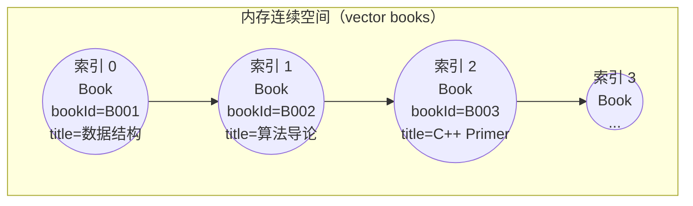

> **特点：** 每个元素紧挨着下一个，`books[1]` 就是 `books[0]` 地址 + `sizeof(Book)`。数据从 `data/books.txt` 加载后逐行解析为 `Book` 对象并 `push_back` 到 vector 中。

#### 为什么选 vector？

| 操作 | 复杂度 | 原因 |
|------|--------|------|
| 按下标随机访问 | O(1) | 连续内存，`baseAddr + index * sizeof(Book)` |
| 末尾追加 | O(1) 均摊 | `push_back`，偶尔需要扩容拷贝 |
| 遍历全部 | O(n) | 一次循环即可 |
| 排序 | O(n log n) | 配合 QuickSort 原地排序 |

#### 代码引用

> **来源：** `include/repositories/BookRepository.h`

```cpp
class BookRepository {
private:
    std::vector<Book> books;   // 主存储：全部图书，支持遍历和排序
    BST<Book> bookIndex;       // 索引：按 bookId 快速查找
    // ...
};
```

> **来源：** `src/repositories/BookRepository.cpp:22-31` —— 新增图书时同步写入 vector 和 BST

```cpp
bool BookRepository::add(const Book& book) {
    if (exists(book.bookId)) {
        return false;            // 重复检查
    }
    books.push_back(book);       // 写入 vector
    bookIndex.insert(book);      // 同步写入 BST 索引
    return true;
}
```

### 2.1.3 BST二叉搜索树核心操作

虽然 vector 支持 O(1) 随机访问，但**按 bookId 查找**只能遍历 vector —— O(n)。为解决这个问题，系统引入了自实现的 `BST<Book>` 模板类作为索引，实现 O(log n) 的按编号查找。

> **来源：** `include/utils/BST.h` —— 完整的头文件模板实现（约 330 行）

#### BST 节点结构

每个节点包含三个成员：**数据域**（存一个 `Book` 对象）、**左子树指针**、**右子树指针**。

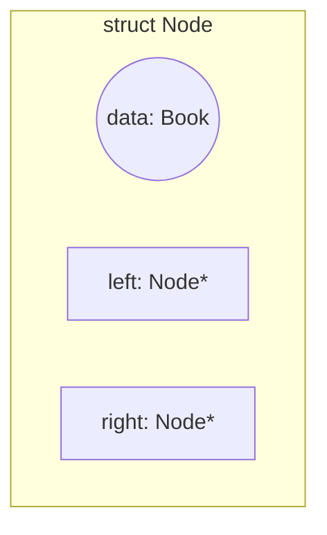

**排序规则（BST 性质）：**
- 左子树所有节点的 `bookId` < 当前节点的 `bookId`
- 右子树所有节点的 `bookId` > 当前节点的 `bookId`
- `Book` 的 `operator<` 按 `bookId` 字典序比较

> **来源：** `include/utils/BST.h:28-35` —— 节点结构定义

```cpp
struct Node {
    T     data;   // 节点存储的数据
    Node* left;   // 左子树指针
    Node* right;  // 右子树指针
    Node(const T& d);
};
```

#### 2.1.3.1 BST插入操作 insert()

向 BST 插入一本新书，遵循"小左大右"规则递归下探，遇到空位即创建节点。**不允许插入重复 bookId**（相等时直接返回，不做任何操作）。

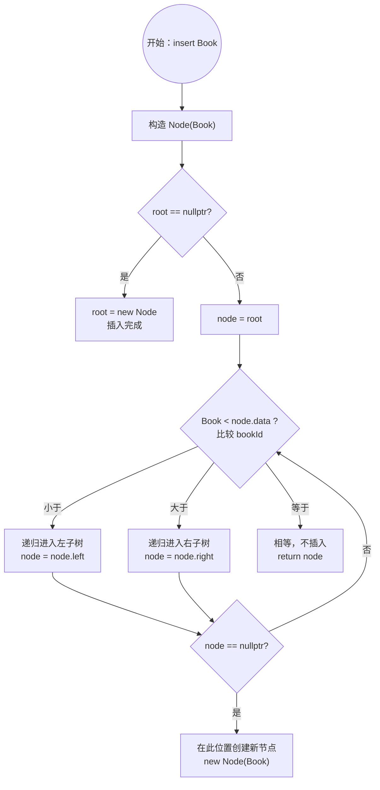

> **来源：** `include/utils/BST.h:159-177` —— 递归插入逻辑

```cpp
template<typename T>
typename BST<T>::Node* BST<T>::insertHelper(Node* node, const T& data) {
    if (node == nullptr) {
        return new Node(data);                 // 到达空位，插入
    }
    if (data < node->data) {
        node->left = insertHelper(node->left, data);    // 左子树
    } else if (node->data < data) {
        node->right = insertHelper(node->right, data);  // 右子树
    }
    // 相等：不插入，直接返回原节点
    return node;
}
```

#### 2.1.3.2 BST查找操作 search()

查找时从根节点出发，比当前节点小则向左，大则向右，等于则命中。每一步排除一半候选，因此复杂度为 O(log n)。

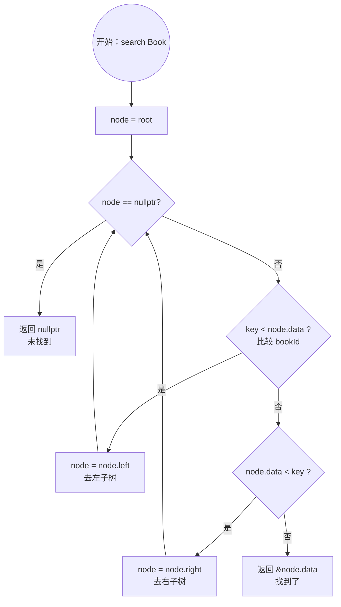

> **来源：** `include/utils/BST.h:200-212` —— 递归二分查找

```cpp
template<typename T>
typename BST<T>::Node* BST<T>::searchHelper(Node* node, const T& key) const {
    if (node == nullptr) return nullptr;                     // 到底了
    if (key < node->data) return searchHelper(node->left, key);   // 左
    if (node->data < key) return searchHelper(node->right, key);  // 右
    return node;                                              // 命中
}
```

> **来源：** `src/repositories/BookRepository.cpp:52-56` —— BookRepository 使用 BST 查找

```cpp
Book* BookRepository::findById(const std::string& bookId) {
    Book key(bookId, "", "", "", 0, 0, 0);  // 构造临时对象
    return bookIndex.search(key);            // BST 查找 O(log n)
}
```

#### 2.1.3.3 BST删除操作 remove()

删除是最复杂的操作，需要分三种情况处理：

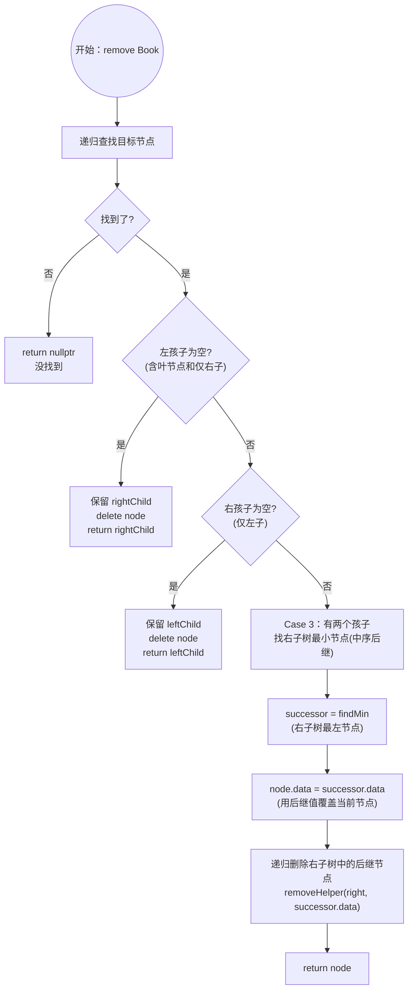

> **来源：** `include/utils/BST.h:238-276` —— 三种情况的删除实现

```cpp
template<typename T>
typename BST<T>::Node* BST<T>::removeHelper(Node* node, const T& key) {
    if (node == nullptr) return nullptr;
    if (key < node->data) {
        node->left = removeHelper(node->left, key);
    } else if (node->data < key) {
        node->right = removeHelper(node->right, key);
    } else {
        // Case 1 + 2：左为空或右为空
        if (node->left == nullptr) {
            Node* rightChild = node->right;
            delete node;
            return rightChild;
        }
        if (node->right == nullptr) {
            Node* leftChild = node->left;
            delete node;
            return leftChild;
        }
        // Case 3：两个子节点，找中序后继
        Node* successor = findMin(node->right);
        node->data = successor->data;                    // 值覆盖
        node->right = removeHelper(node->right, successor->data);  // 删后继
    }
    return node;
}
```

#### 2.1.3.4 BST整体结构示例（实际插入示例）

假设依次插入 `bookId = B005, B002, B008, B001, B003, B007, B010`，最终 BST 形态如下：

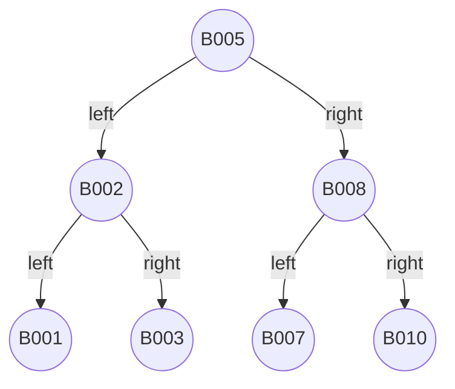

> 查找 B007：B005 → 右 → B008 → 左 → B007，3 步即可（而 vector 需要遍历 6 次）。这就是 O(log n) vs O(n) 的差异。

### 2.1.4 QuickSort排序算法（Lomuto分区）

系统在 **借阅排行榜** 功能中需要对全部图书按 `borrowCount`（历史借阅次数）降序排列。使用自实现的 QuickSort，采用 **Lomuto 分区方案**（选最后一个元素为 pivot）。

> **来源：** `include/utils/SortAlgorithms.h` —— 模板类，约 109 行

#### QuickSort 整体流程

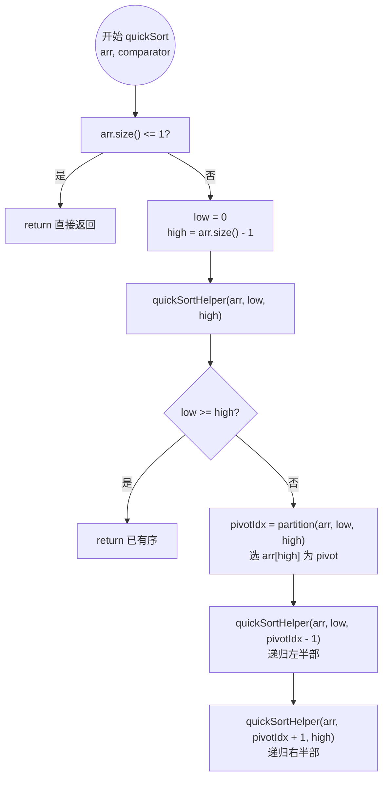

#### Lomuto 分区算法详细流程

这是 QuickSort 的核心——将数组按 pivot 划分为"小元素区"和"大元素区"。

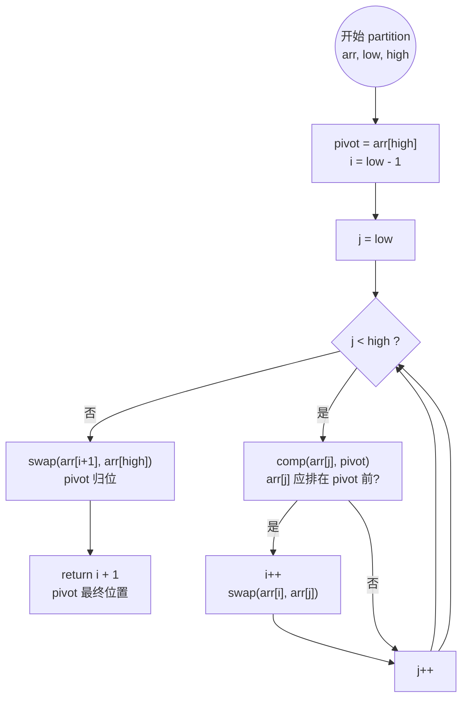

> **来源：** `include/utils/SortAlgorithms.h:92-108` —— Lomuto 分区实现

```cpp
template<typename T>
int SortAlgorithms::partition(std::vector<T>& arr, int low, int high,
                              std::function<bool(const T&, const T&)> comp) {
    T pivot = arr[high];               // 选最后一个元素为基准
    int i = low - 1;                    // i 指向小元素区末尾
    for (int j = low; j < high; ++j) {
        if (comp(arr[j], pivot)) {      // arr[j] 应排在 pivot 前面
            ++i;
            std::swap(arr[i], arr[j]);
        }
    }
    std::swap(arr[i + 1], arr[high]);  // pivot 放到正确位置
    return i + 1;
}
```

#### 实际使用场景：借阅排行榜

> **来源：** `src/managers/StatisticsManager.cpp` —— `getBorrowRanking()` 方法

```cpp
// 复制全部图书，按 borrowCount 降序排列
std::vector<Book> books = bookRepo.getAll();  // 从 vector 拷贝
SortAlgorithms::quickSort<Book>(books,
    [](const Book& a, const Book& b) {
        return a.borrowCount > b.borrowCount;  // 降序：大的排前面
    });
// 取前 topN 本返回
```

#### 复杂度分析

| 情况 | 时间复杂度 | 空间复杂度 | 何时发生 |
|------|-----------|-----------|---------|
| 平均 | O(n log n) | O(log n)（递归栈） | 每次 pivot 大致将数组平分 |
| 最好 | O(n log n) | O(log n) | 每次 pivot 恰好是中位数 |
| 最坏 | O(n²) | O(n) | 数组已有序，pivot 总是最大/最小元素 |

---

## 2.2 顺序表与线性查找算法（读者数据）

**涉及文件：** `include/models/Reader.h`, `include/repositories/ReaderRepository.h/.cpp`

### 2.2.1 Reader 数据模型定义

每个 Reader 对象包含 5 个字段，记录读者的基本身份信息和状态。

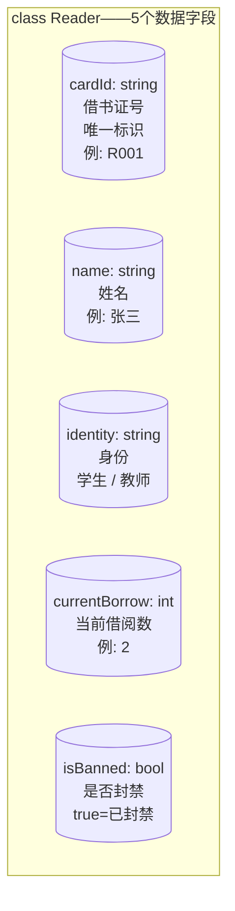

> **来源：** `include/models/Reader.h:84-89` —— 数据字段声明

```cpp
class Reader {
public:
    std::string cardId;          // 借书证号（唯一标识）
    std::string name;            // 姓名
    std::string identity;        // 身份："学生" / "教师"
    int         currentBorrow;   // 当前借阅数量
    bool        isBanned;        // 是否封禁（true = 已封禁）
};
```

#### 构造函数

> **来源：** `src/models/Reader.cpp:17-38`

```cpp
// 默认构造函数 —— 身份为空，未封禁
Reader::Reader()
    : cardId("")
    , name("")
    , identity("")
    , currentBorrow(0)
    , isBanned(false)
{
}

// 带参构造函数
Reader::Reader(const std::string& id, const std::string& n,
               const std::string& ident, int borrow, bool banned)
    : cardId(id)
    , name(n)
    , identity(ident)
    , currentBorrow(borrow)
    , isBanned(banned)
{
}
```

#### 文件持久化格式

`data/readers.txt` 中每行格式：`cardId|name|identity|currentBorrow|isBanned(1/0)`

```
R001|张三|学生|2|0
R002|李四|教师|1|1
```

> **来源：** `src/models/Reader.cpp:123-157`

```cpp
// 对象 → 字符串
std::string Reader::toFileString() const {
    std::ostringstream oss;
    oss << cardId << "|" << name << "|" << identity << "|"
        << currentBorrow << "|" << (isBanned ? "1" : "0");
    return oss.str();
}

// 字符串 → 对象
Reader Reader::fromFileString(const std::string& line) {
    // 按 | 拆分 → Reader(id, name, identity, borrow, fields[4]=="1")
    // ...
}
```

读者数据的存储策略比图书简单：仅用 `std::vector<Reader>` 存放，查找时线性扫描。这是因为读者数量通常很小（系统测试数据仅 10 条），O(n) 足够。

### 2.2.2 底层数据结构：vector顺序表

#### 数据在内存中的存储方式

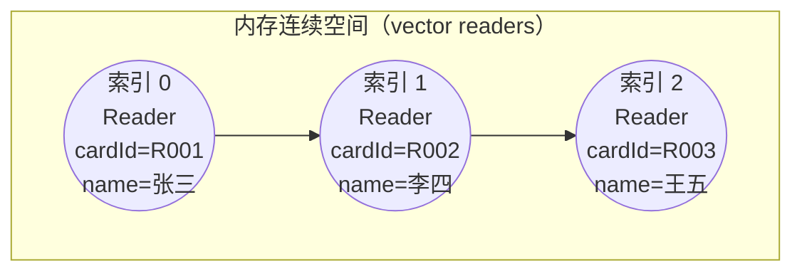

> **选型原因：** 读者总数有限，不需要 BST 索引。单一 vector 结构更简单，增删改查足够快。`Reader` 模型只有 5 个字段（cardId, name, identity, currentBorrow, isBanned），数据量小。

> **来源：** `include/repositories/ReaderRepository.h`

```cpp
class ReaderRepository {
private:
    std::vector<Reader> readers;   // 唯一存储结构，无索引
};
```

### 2.2.3 线性查找算法

按 `cardId` 查找读者，从头到尾遍历 vector，逐一比对。

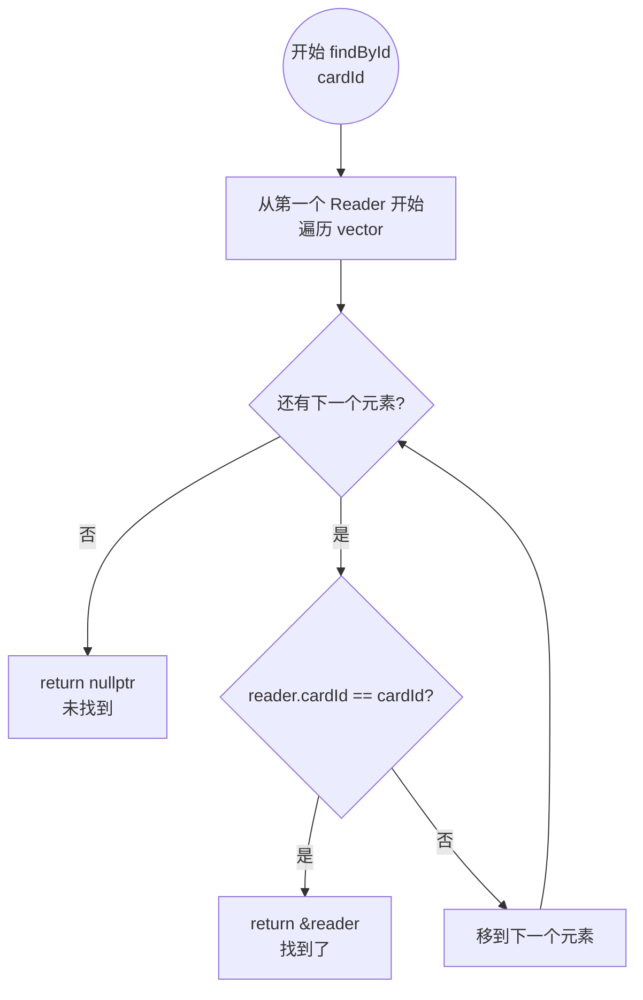

> **来源：** `src/repositories/ReaderRepository.cpp:44-51`

```cpp
Reader* ReaderRepository::findById(const std::string& cardId) {
    for (auto& reader : readers) {
        if (reader.cardId == cardId) {
            return &reader;
        }
    }
    return nullptr;
}
```

### 2.2.4 CRUD 操作流程

#### 新增读者 `add()`

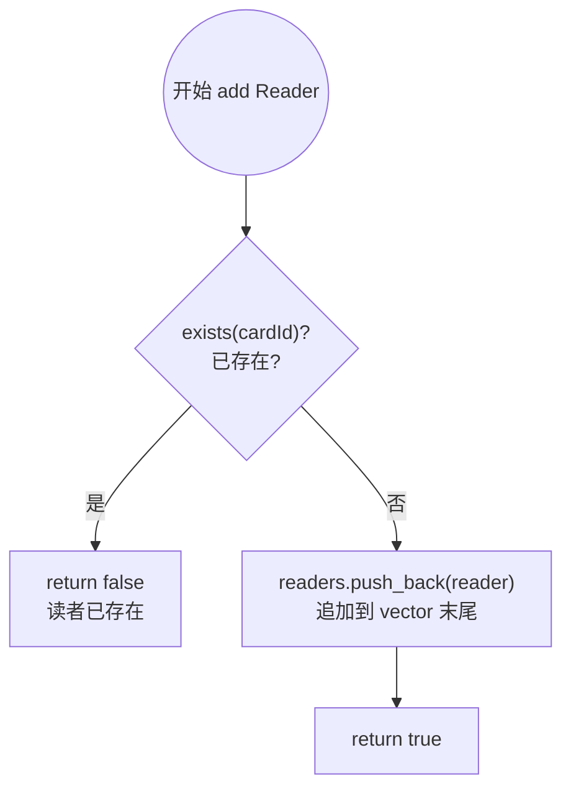

#### 删除读者 `remove()`

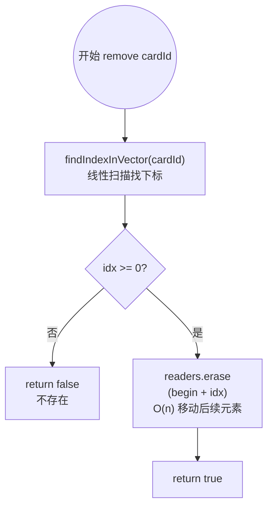

> **来源：** `src/repositories/ReaderRepository.cpp:19-37`

```cpp
bool ReaderRepository::add(const Reader& reader) {
    if (exists(reader.cardId)) return false;    // 重复检查
    readers.push_back(reader);
    return true;
}

bool ReaderRepository::remove(const std::string& cardId) {
    int idx = findIndexInVector(cardId);        // 线性查找
    if (idx < 0) return false;
    readers.erase(readers.begin() + idx);       // O(n) 移动
    return true;
}
```

#### 业务规则

读者在借阅时受身份限制：

| 身份 | 最大借阅数 |
|------|-----------|
| 学生 ("xue sheng") | 3 本 |
| 教师 ("jiao shi") | 5 本 |

> **来源：** `include/managers/LoanManager.h` —— 静态常量定义

```cpp
static constexpr int MAX_BORROW_STUDENT = 3;
static constexpr int MAX_BORROW_TEACHER = 5;
```

---

## 2.3 双向链表与借阅业务算法（借阅数据）

**涉及文件：** `include/models/Loan.h`, `include/repositories/LoanRepository.h/.cpp`, `include/managers/LoanManager.h/.cpp`, `include/utils/DateUtils.h/.cpp`

### 2.3.1 Loan 数据模型定义

Loan 记录一次借阅的全部信息，包括关联的图书和读者（通过 bookId/cardId 外键）、时间线（借阅日期、到期日期）、状态（是否归还、是否续借）和罚款金额。

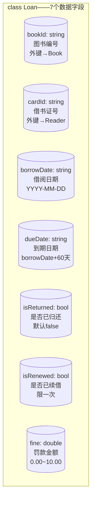

> **来源：** `include/models/Loan.h:87-94` —— 数据字段声明

```cpp
class Loan {
public:
    std::string bookId;          // 图书编号
    std::string cardId;          // 借书证号
    std::string borrowDate;      // 借阅日期（格式：YYYY-MM-DD）
    std::string dueDate;         // 到期日期（格式：YYYY-MM-DD）
    bool        isReturned;      // 是否归还
    bool        isRenewed;       // 是否续借（每本书限续借一次）
    double      fine;            // 当前罚款金额（0.00 ~ 10.00）
};
```

#### 构造函数

> **来源：** `src/models/Loan.cpp:17-44`

```cpp
// 默认构造 —— 默认未归还、未续借、无罚款
Loan::Loan()
    : bookId("")
    , cardId("")
    , borrowDate("")
    , dueDate("")
    , isReturned(false)
    , isRenewed(false)
    , fine(0.0)
{
}

// 全参构造 —— 例如借书时：Loan(bookId, cardId, today, today+60, false, false, 0.0)
Loan::Loan(const std::string& bId, const std::string& cId,
           const std::string& bDate, const std::string& dDate,
           bool returned, bool renewed, double f)
    : bookId(bId)
    , cardId(cId)
    , borrowDate(bDate)
    , dueDate(dDate)
    , isReturned(returned)
    , isRenewed(renewed)
    , fine(f)
{
}
```

#### 文件持久化格式

`data/loans.txt` 每行：`bookId|cardId|borrowDate|dueDate|isReturned(1/0)|isRenewed(1/0)|fine`

```
B001|R001|2024-01-15|2024-03-15|1|0|0.00
B002|R001|2024-02-01|2024-04-01|0|1|0.00
```

> **来源：** `src/models/Loan.cpp:116-154`

```cpp
// 对象 → 字符串
std::string Loan::toFileString() const {
    std::ostringstream oss;
    oss << bookId << "|" << cardId << "|" << borrowDate << "|"
        << dueDate << "|" << (isReturned ? "1" : "0") << "|"
        << (isRenewed ? "1" : "0") << "|" << fine;
    return oss.str();
}

// 字符串 → 对象
Loan Loan::fromFileString(const std::string& line) {
    // 按 | 拆分 → Loan(bId, cId, bDate, dDate, returned, renewed, fine)
    // ...
}
```

借阅记录是整个系统**增删最频繁**的数据。每次借书新增一条，还书标记归还，还需要频繁遍历查找活跃记录。因此选用 `std::list`（双向链表）。

### 2.3.2 底层数据结构：list双向链表

#### 链表 vs 顺序表的抉择

| 特性 | `std::vector` | `std::list` |
|------|--------------|-------------|
| 随机访问 | O(1) | O(n) |
| 头尾插入/删除 | 尾部 O(1)，头部 O(n) | O(1) |
| 中间插入/删除 | O(n)（移动后续元素） | O(1)（改指针） |
| **迭代器失效** | 插入可能全部失效（扩容） | **不失效**（只改指针） |

**LoanRepository 选 list 的关键原因：迭代器不失效**。借阅记录在归还时只需改 `isReturned` 和 `fine` 字段，不需要删除节点本身——如果使用 vector，一旦有其他记录插入导致扩容，之前持有的指针/迭代器就全部失效了。

#### 链表节点结构

```mermaid
flowchart LR
    subgraph 双向链表["std::list<Loan> 双向链表"]
        direction LR
        A("◄ prev<br/>Loan{bookId=B001<br/>cardId=R001<br/>isReturned=false}")
        B("◄ prev | next ►<br/>Loan{bookId=B002<br/>cardId=R001<br/>isReturned=false}")
        C("prev | next ►<br/>Loan{bookId=B001<br/>cardId=R002<br/>isReturned=true}")
    end
    A -.->|next| B
    B -.->|prev| A
    B -.->|next| C
    C -.->|prev| B
```

> 每个节点存一个 `Loan` 记录 + `prev`指针 + `next`指针。删除 B 只需要将 A.next 指向 C，C.prev 指向 A——O(1)。而 vector 删除中间元素需要将 C 及之后的所有元素向前移动——O(n)。

> **来源：** `include/repositories/LoanRepository.h`

```cpp
class LoanRepository {
private:
    std::list<Loan> loans;   // 双向链表存储全部借阅记录
};
```

#### 链表遍历查找

虽然 list 不支持随机访问，但系统需要在链表中查找特定记录（如某读者+某书的活跃借阅）。

```mermaid
flowchart TD
    Start(("开始遍历查找<br/>bookId + cardId"))
    Init["it = loans.begin()"]
    Loop{"it != loans.end()?"}
    NotFound["return nullptr<br/>未找到"]
    Match{"loan.bookId == bookId<br/>&& loan.cardId == cardId<br/>&& !loan.isReturned?"}
    Found["return &(*it)<br/>找到了"]
    Next["++it<br/>移到下一节点"]

    Start --> Init --> Loop
    Loop -->|否| NotFound
    Loop -->|是| Match
    Match -->|是| Found
    Match -->|否| Next --> Loop
```

> **来源：** `src/repositories/LoanRepository.cpp:51-61`

```cpp
Loan* LoanRepository::findActive(const std::string& bookId,
                                  const std::string& cardId) {
    for (auto& loan : loans) {
        if (loan.bookId == bookId &&
            loan.cardId == cardId &&
            !loan.isReturned) {
            return &loan;
        }
    }
    return nullptr;
}
```

### 2.3.3 borrowBook 借阅流程

借书是整个系统最核心、最复杂的业务流程，共 9 个步骤。前 5 步是**校验**（任一失败立即返回），后 4 步是**状态更新**。

```mermaid
flowchart TD
    Start(("borrowBook<br/>bookId, cardId"))
    S1{"步骤1：checkReaderExists<br/>读者存在?"}
    E1["错误：读者不存在"]
    S2{"步骤2：checkReaderNotBanned<br/>未被封禁?"}
    E2["错误：已被封禁"]
    S3{"步骤3：checkBorrowLimit<br/>未超借阅上限?"}
    E3["错误：已达上限<br/>学生3本/教师5本"]
    S4{"步骤4：checkBookExists<br/>图书存在? 走BST"}
    E4["错误：图书不存在"]
    S5{"步骤5：checkBookStock<br/>库存 > 0?"}
    E5["错误：库存不足"]
    S6["步骤6：createLoanRecord<br/>today=getToday()<br/>dueDate=today+60天<br/>loanRepo.add(loan)→list"]
    S7["步骤7：decrementBookStock<br/>book.currentStock--<br/>bookRepo.update→BST同步"]
    S8["步骤8：incrementBookBorrowCount<br/>book.borrowCount++"]
    S9["步骤9：incrementReaderBorrowCount<br/>reader.currentBorrow++"]
    Success["return true<br/>借阅成功"]

    Start --> S1
    S1 -->|否| E1
    S1 -->|是| S2
    S2 -->|否| E2
    S2 -->|是| S3
    S3 -->|否| E3
    S3 -->|是| S4
    S4 -->|否| E4
    S4 -->|是| S5
    S5 -->|否| E5
    S5 -->|是| S6 --> S7 --> S8 --> S9 --> Success
```

> **来源：** `src/managers/LoanManager.cpp:130-161` —— 借书入口函数

```cpp
bool LoanManager::borrowBook(const std::string& bookId, const std::string& cardId) {
    Reader* reader = checkReaderExists(cardId);       // 步骤1
    if (reader == nullptr) return false;
    if (!checkReaderNotBanned(reader)) return false;  // 步骤2
    if (!checkBorrowLimit(reader)) return false;      // 步骤3
    Book* book = checkBookExists(bookId);             // 步骤4（走BST O(log n)）
    if (book == nullptr) return false;
    if (!checkBookStock(book)) return false;          // 步骤5
    createLoanRecord(bookId, cardId);                 // 步骤6
    decrementBookStock(book);                         // 步骤7
    incrementBookBorrowCount(book);                   // 步骤8
    incrementReaderBorrowCount(reader);               // 步骤9
    return true;
}
```

### 2.3.4 returnBook 归还流程（含罚款与自动封禁）

归还流程比借书稍简单，共 6 步，其中第 2 步涉及罚款计算，第 6 步涉及自动封禁判断。

```mermaid
flowchart TD
    Start(("returnBook<br/>bookId, cardId"))
    S1["步骤1：findActiveLoanRecord<br/>遍历 list 找活跃借阅"]
    Found{"找到了?"}
    E1["错误：无活跃借阅记录"]
    S2["步骤2：calculateFine<br/>today = getToday()<br/>overdueDays = today - dueDate<br/>fine = min(overdueDays × 1.0, 10.0)"]
    S3["步骤3：markLoanReturned<br/>loan.isReturned = true<br/>loan.fine = fine"]
    S4["步骤4：restoreBookStock<br/>book.currentStock++<br/>bookRepo.update→BST同步"]
    S5["步骤5：decrementReaderBorrowCount<br/>reader.currentBorrow--"]
    S6["步骤6：checkAndAutoBan<br/>累计罚款 ≥ 10 ?"]
    BanYes["reader.isBanned = true<br/>自动封禁"]
    BanNo["无需封禁"]
    Success["return true<br/>归还成功"]
    PrintFine["打印罚款金额"]

    Start --> S1 --> Found
    Found -->|否| E1
    Found -->|是| S2 --> PrintFine --> S3 --> S4 --> S5 --> S6
    S6 --> S6Check{"getTotalFine(cardId)<br/>≥ 10 元?"}
    S6Check -->|是| BanYes
    S6Check -->|否| BanNo
    BanYes --> Success
    BanNo --> Success
```

#### 罚款计算公式

```
overdueDays = today - dueDate  （天数差）           // DateUtils::daysBetween()
fine = overdueDays > 0 ? min(overdueDays × 1.0, 10.0) : 0.0
```

每超期 1 天罚款 1 元，**封顶 10 元**。

> **来源：** `src/managers/LoanManager.cpp:290-299`

```cpp
double LoanManager::calculateFine(const std::string& returnDate,
                                  const std::string& dueDate) const {
    int overdueDays = DateUtils::daysBetween(dueDate, returnDate);
    if (overdueDays <= 0) return 0.0;
    double fine = static_cast<double>(overdueDays) * FINE_PER_DAY;  // ×1.0
    return std::min(fine, MAX_FINE);  // 封顶 10.0
}
```

#### 自动封禁算法

还书后，系统自动计算该读者的**历史累计罚款总额**，若 ≥ 10 元则自动封禁。

> **来源：** `src/managers/LoanManager.cpp:306-319`

```cpp
void LoanManager::checkAndAutoBan(const std::string& cardId) {
    double totalFine = loanRepo.getTotalFineByReaderId(cardId);  // 遍历全部借阅求罚款和
    if (totalFine < MAX_FINE) return;
    Reader* reader = readerRepo.findById(cardId);
    if (reader != nullptr && !reader->isBanned) {
        reader->isBanned = true;
        readerRepo.update(*reader);
    }
}
```

> **来源：** `src/repositories/LoanRepository.cpp:138-146` —— 累计罚款查询

```cpp
double LoanRepository::getTotalFineByReaderId(const std::string& cardId) {
    double total = 0.0;
    for (const auto& loan : loans) {   // 遍历 list 的全部借阅记录
        if (loan.cardId == cardId) {
            total += loan.fine;
        }
    }
    return total;
}
```

### 2.3.5 renewBook 续借流程

续借只允许**一次**，且须在**到期前 15 天内**操作。续借后到期日**延长 60 天**。

```mermaid
flowchart TD
    Start(("renewBook<br/>bookId, cardId"))
    S1["步骤1：findActiveLoanRecord<br/>遍历 list 找活跃借阅"]
    Found{"找到了?"}
    E1["错误：无活跃借阅记录"]
    S2{"步骤2：checkNotAlreadyRenewed<br/>loan.isRenewed == false?"}
    E2["错误：已续借过一次"]
    S3{"步骤3：checkWithinRenewWindow<br/>daysRemaining = dueDate - today"}
    E3Overdue["错误：已超期"]
    E3Early["错误：距到期>15天<br/>不能续借"]
    S4["步骤4：extendDueDate<br/>dueDate += 60天"]
    S5["步骤5：markLoanRenewed<br/>loan.isRenewed = true"]
    Success["return true<br/>续借成功"]

    Start --> S1 --> Found
    Found -->|否| E1
    Found -->|是| S2
    S2 -->|否| E2
    S2 -->|是| S3
    S3 -->|daysRemaining < 0| E3Overdue
    S3 -->|daysRemaining > 15| E3Early
    S3 -->|0 ≤ days ≤ 15| S4 --> S5 --> Success
```

> **来源：** `src/managers/LoanManager.cpp:266-284` —— 续借入口

```cpp
bool LoanManager::renewBook(const std::string& bookId, const std::string& cardId) {
    Loan* loan = findActiveLoanRecord(bookId, cardId);
    if (loan == nullptr) return false;
    if (!checkNotAlreadyRenewed(loan)) return false;    // 已续借过？
    if (!checkWithinRenewWindow(loan)) return false;    // 在窗口内？
    extendDueDate(loan);                                 // +60天
    markLoanRenewed(loan);
    return true;
}
```

### 2.3.6 日期计算算法：绝对天数转换

本系统所有日期运算（借阅 60 天到期、超期天数、续借延期等）都依赖 `DateUtils`。其核心思想是：**将 "YYYY-MM-DD" 格式的日期转换为"从公元 0000-01-01 起算的绝对天数"**，然后直接做整数加减，再转换回去。

```mermaid
flowchart TD
    Start(("输入：2024-03-15"))
    Parse["parseDate: 拆分为 y=2024, m=3, d=15"]
    Sub1["步骤A：累加整年天数<br/>for y=0 to 2023:<br/>  total+=闰年?366:365"]
    Sub2["步骤B：累加整月天数<br/>for m=1 to 2(1月+2月):<br/>  total+=daysInMonth(2024,m)<br/>  注意2月闰年=29天"]
    Sub3["步骤C：加上当月天数<br/>total+=15"]
    Result["结果：绝对天数 = 739,xxx<br/>这是一个整数，可直接加减"]

    Start --> Parse --> Sub1 --> Sub2 --> Sub3 --> Result
```

#### 具体示例：计算 2024-01-15 借书，60 天后的到期日

```
1. "2024-01-15" → dateToDays() → 739,250（假设值）
2. 739,250 + 60 = 739,310
3. 739,310 → daysToDate() → "2024-03-15"
```

> **来源：** `src/utils/DateUtils.cpp:79-92` —— 绝对天数转换

```cpp
int DateUtils::dateToDays(int year, int month, int day) {
    int total = 0;
    for (int y = 0; y < year; ++y) {            // 累加整年
        total += isLeapYear(y) ? 366 : 365;
    }
    for (int m = 1; m < month; ++m) {           // 累加整月
        total += daysInMonth(year, m);
    }
    total += day;                                // 累计天
    return total;
}
```

> **来源：** `src/utils/DateUtils.cpp:120-125` —— 两天之间的天数差

```cpp
int DateUtils::daysBetween(const std::string& d1, const std::string& d2) {
    int y1, m1, d1d, y2, m2, d2d;
    parseDate(d1, y1, m1, d1d);
    parseDate(d2, y2, m2, d2d);
    return dateToDays(y2, m2, d2d) - dateToDays(y1, m1, d1d);  // 绝对值之差
}
```

---

## 2.4 键值队列与FIFO预约调度算法（预约数据）

**涉及文件：** `include/models/Reservation.h`, `include/repositories/ReservationRepository.h/.cpp`, `include/managers/ReservationManager.h/.cpp`

### 2.4.1 Reservation 数据模型定义

Reservation 是所有模型中最简洁的一个，仅 3 个字段：记录谁（cardId）预约了哪本书（bookId）以及预约时间。

```mermaid
flowchart TD
    subgraph ReservationClass["class Reservation——3个数据字段"]
        direction LR
        RS1[("bookId: string<br/>图书编号<br/>预约哪本书")]
        RS2[("cardId: string<br/>借书证号<br/>谁来预约")]
        RS3[("reserveDate: string<br/>预约日期<br/>YYYY-MM-DD")]
    end
```

> **来源：** `include/models/Reservation.h:73-76` —— 数据字段声明

```cpp
class Reservation {
public:
    std::string bookId;       // 图书编号
    std::string cardId;       // 借书证号
    std::string reserveDate;  // 预约日期（YYYY-MM-DD）
};
```

#### 构造函数

> **来源：** `src/models/Reservation.cpp:17-32`

```cpp
// 默认构造 —— 所有字段置空
Reservation::Reservation()
    : bookId("")
    , cardId("")
    , reserveDate("")
{
}

// 带参构造 —— 预约时调用 Reservation(bookId, cardId, today)
Reservation::Reservation(const std::string& bId,
                         const std::string& cId,
                         const std::string& rDate)
    : bookId(bId)
    , cardId(cId)
    , reserveDate(rDate)
{
}
```

#### 文件持久化格式

`data/reservations.txt` 每行：`bookId|cardId|reserveDate`

```
B001|R003|2024-01-10
B001|R005|2024-01-12
B003|R002|2024-02-01
```

> **来源：** `src/models/Reservation.cpp:70-98`

```cpp
// 对象 → 字符串
std::string Reservation::toFileString() const {
    std::ostringstream oss;
    oss << bookId << "|" << cardId << "|" << reserveDate;
    return oss.str();
}

// 字符串 → 对象
Reservation Reservation::fromFileString(const std::string& line) {
    // 按 | 拆分 → Reservation(bookId, cardId, reserveDate)
    // ...
}
```

当某书库存为 0 时，读者可以**预约排队**。每本书各自维护一个 **FIFO 队列**（先预约先得），还书时从队头弹出第一个预约者并通知取书。

### 2.4.2 底层数据结构：map + deque键值队列

#### 数据结构全景

```mermaid
flowchart TD
    subgraph map结构["std::map<string, deque<Reservation>> reservations"]
        direction LR
        K1["key: B001 →"]
        DQ1(("deque[B001]<br/>队头→队尾<br/>[R001|2024-01-10]<br/>[R003|2024-01-12]<br/>[R005|2024-01-15]"))
        K2["key: B002 →"]
        DQ2(("deque[B002]<br/>[R002|2024-02-01]"))
        K3["key: B005 →"]
        DQ3(("deque[B005]<br/>空队列"))
    end
    K1 --> DQ1
    K2 --> DQ2
    K3 --> DQ3
```

#### 选型分析

| 组件 | 选择 | 理由 |
|------|------|------|
| 外层 `map` | `std::map<string, ...>` | key=bookId，O(log n) 定位到对应书的队列（底层红黑树） |
| 内层队列 | `std::deque<Reservation>` | 支持 push_back（排队）/ pop_front（出队）/ erase（取消预约）/ 迭代器遍历（持久化） |
| 为什么不用 `queue`？ | — | `std::queue` 不支持遍历和中间删除，无法实现文件序列化和取消预约 |

> **来源：** `include/repositories/ReservationRepository.h`

```cpp
class ReservationRepository {
private:
    std::map<std::string, std::deque<Reservation>> reservations;
    // key: bookId, value: 该书的预约FIFO队列
};
```

#### FIFO 队列的三种操作

```mermaid
flowchart LR
    subgraph 排队["排队 push_back"]
        direction LR
        Q1H["队头: R001"]
        Q1M["R003"]
        Q1T["队尾: R005 ←"]
        New1["新: R008 → 追加到队尾"]
    end

    subgraph 出队["出队 pop_front"]
        direction LR
        Q2H["队头: R001 → 弹出"]
        Q2M["R003 → 新队头"]
        Q2T["队尾: R005"]
    end

    subgraph 取消["取消 erase"]
        direction LR
        Q3H["队头: R001"]
        Q3M["R003 → 删除"]
        Q3T["队尾: R005"]
    end
```

> **来源：** `src/repositories/ReservationRepository.cpp`

```cpp
// 排队 - push_back 追加到队尾
bool ReservationRepository::add(const Reservation& reservation) {
    reservations[reservation.bookId].push_back(reservation);
    return true;
}

// 出队 - pop_front 从队头取出
Reservation ReservationRepository::popNext(const std::string& bookId) {
    auto it = reservations.find(bookId);
    if (it == reservations.end() || it->second.empty()) return Reservation();
    Reservation front = it->second.front();
    it->second.pop_front();
    if (it->second.empty()) reservations.erase(it);  // 队列空则删key
    return front;
}

// 取消 - erase 中间任意元素
bool ReservationRepository::remove(const std::string& bookId, const std::string& cardId) {
    auto it = reservations.find(bookId);
    if (it == reservations.end()) return false;
    std::deque<Reservation>& queue = it->second;
    for (auto qi = queue.begin(); qi != queue.end(); ++qi) {
        if (qi->cardId == cardId) {
            queue.erase(qi);                          // O(n) 但队列通常很短
            if (queue.empty()) reservations.erase(it);
            return true;
        }
    }
    return false;
}
```

### 2.4.3 reserveBook 预约流程

预约前有 **7 步校验**，确保读者只能预约**库存为 0 且自己未借未约**的书。

```mermaid
flowchart TD
    Start(("reserveBook<br/>bookId, cardId"))
    S1{"步骤1：读者存在?"}
    E1["错误：读者不存在"]
    S2{"步骤2：未被封禁?"}
    E2["错误：已被封禁"]
    S3{"步骤3：图书存在? (BST)"}
    E3["错误：图书不存在"]
    S4{"步骤4：库存 == 0?"}
    E4["错误：库存充足，请直接借书"]
    S5{"步骤5：未借阅此书?"}
    E5["错误：已借阅，无需预约"]
    S6{"步骤6：未预约过?"}
    E6["错误：已预约过，勿重复"]
    S7["步骤7：创建预约<br/>today = getToday()<br/>res = Reservation(bookId,cardId,today)<br/>reservationRepo.add(res)<br/>→ map[bookId].deque.push_back(res)"]
    Success["return true<br/>预约成功<br/>当前排队位置: queueSize"]

    Start --> S1 -->|否| E1
    S1 -->|是| S2 -->|否| E2
    S2 -->|是| S3 -->|否| E3
    S3 -->|是| S4 -->|否| E4
    S4 -->|是| S5 -->|否| E5
    S5 -->|是| S6 -->|否| E6
    S6 -->|是| S7 --> Success
```

> **来源：** `src/managers/ReservationManager.cpp:30-80`

```cpp
bool ReservationManager::reserveBook(const std::string& bookId, const std::string& cardId) {
    Reader* reader = readerRepo.findById(cardId);             // 步骤1
    if (reader == nullptr) { setError("..."); return false; }
    if (reader->isBanned) { setError("..."); return false; }  // 步骤2
    Book* book = bookRepo.findById(bookId);                   // 步骤3 BST
    if (book == nullptr) { setError("..."); return false; }
    if (book->currentStock > 0) { setError("..."); return false; }  // 步骤4
    Loan* activeLoan = loanRepo.findActive(bookId, cardId);  // 步骤5
    if (activeLoan != nullptr) { setError("..."); return false; }
    if (reservationRepo.hasReservation(bookId, cardId)) {     // 步骤6
        setError("..."); return false;
    }
    std::string today = DateUtils::getToday();                 // 步骤7
    Reservation res(bookId, cardId, today);
    reservationRepo.add(res);   // map[bookId].deque.push_back()
    return true;
}
```

### 2.4.4 processReturnedBook 归还触发出队

此方法在 **还书成功后** 由 `main.cpp` 调用。它从刚归还的书的预约队列中 pop 出队头预约者，校验其是否仍然有效（存在且未被封禁），然后打印通知。

```mermaid
flowchart TD
    Start(("processReturnedBook<br/>bookId"))
    Pop["next = reservationRepo.popNext(bookId)<br/>FIFO 弹出队头预约"]
    Empty{"next.bookId 为空?<br/>无预约"}
    NoRes["无预约记录<br/>直接返回"]
    CheckReader["reader = readerRepo.findById(next.cardId)"]
    ReaderNull{"读者存在?"}
    NotifyDeleted["打印：预约者已不存在"]
    CheckBan{"读者被封禁?"}
    NotifyBanned["打印：预约者已被封禁<br/>预约自动取消"]
    NotifyValid["打印：请通知读者前来借阅<br/>预约日期: next.reserveDate<br/>⚠ 不自动借阅，读者需自行操作"]
    Done(("流程结束"))

    Start --> Pop --> Empty
    Empty -->|是| NoRes --> Done
    Empty -->|否| CheckReader --> ReaderNull
    ReaderNull -->|否| NotifyDeleted --> Done
    ReaderNull -->|是| CheckBan
    CheckBan -->|是| NotifyBanned --> Done
    CheckBan -->|否| NotifyValid --> Done
```

> **来源：** `src/managers/ReservationManager.cpp:91-113`

```cpp
void ReservationManager::processReturnedBook(const std::string& bookId) {
    Reservation next = reservationRepo.popNext(bookId);  // FIFO出队
    if (next.bookId.empty()) return;                      // 无人预约

    Reader* reader = readerRepo.findById(next.cardId);
    if (reader == nullptr) {
        std::cout << "预约者 [" << next.cardId << "] 已不存在" << std::endl;
    } else if (reader->isBanned) {
        std::cout << "预约者 [" << next.cardId << "] 已被封禁，预约自动取消" << std::endl;
    } else {
        std::cout << "请通知读者 [" << next.cardId << "] 前来借阅" << std::endl;
        // 注意：不自动执行借阅操作，读者需自行到借书界面操作
    }
}
```

> **重要提示：** 预约出队后**不会自动借阅**。原因是预约者可能已经达到借阅上限，或不再需要此书。系统只负责通知，实际借阅由读者自行操作。

---

> 本文档所有代码均来自 `library-system-demo` 项目，流程图使用 Mermaid 语法绘制。

---

# 第3章 系统实现

## 3.1 主界面与菜单系统

系统采用控制台字符界面，启动后直接进入主菜单，提供5个功能入口。界面使用UTF-8编码输出中文，通过Windows API `SetConsoleOutputCP(CP_UTF8)` 解决中文乱码问题。

### 主菜单界面

```
==================================================
             图书管理系统
==================================================
  1. 图书管理
  2. 读者管理
  3. 借阅管理
  4. 统计分析
  5. 退出系统
==================================================
请选择 [1-5]：
```

### 系统初始化流程

```mermaid
flowchart TD
    Start(("程序启动"))
    SetUTF["设置控制台UTF-8编码<br/>SetConsoleOutputCP(CP_UTF8)"]
    CreateDM["创建DataManager<br/>指定数据目录 data/"]
    LoadFiles["加载4个txt数据文件<br/>books.txt / readers.txt<br/>loans.txt / reservations.txt"]
    CreateRepo["创建4个Repository<br/>并将加载数据逐条add"]
    CreateMgr["创建5个Manager<br/>传入对应Repository引用"]
    MainLoop{主循环<br/>running == true?}
    ShowMenu["显示主菜单<br/>读取用户选择"]
    Dispatch["switch(choice)<br/>1→图书管理 2→读者管理<br/>3→借阅管理 4→统计分析<br/>5→退出"]
    SaveExit["overwriteBooks/Readers/<br/>Loans/Reservations<br/>数据写回txt文件"]
    End(("程序结束"))

    Start --> SetUTF --> CreateDM --> LoadFiles --> CreateRepo --> CreateMgr --> MainLoop
    MainLoop -->|是| ShowMenu --> Dispatch --> MainLoop
    MainLoop -->|否| SaveExit --> End
```

> **来源：** `main.cpp:78-164` —— 主函数三部分结构

```cpp
int main() {
    // 设置UTF-8编码
    SetConsoleOutputCP(CP_UTF8);
    SetConsoleCP(CP_UTF8);

    // ===== 第1部分：初始化 =====
    DataManager dataMgr("data/");
    std::vector<Book>   loadedBooks   = dataMgr.loadBooks();
    std::vector<Reader> loadedReaders = dataMgr.loadReaders();
    std::list<Loan>     loadedLoans   = dataMgr.loadLoans();
    std::vector<Reservation> loadedReservations = dataMgr.loadReservations();

    BookRepository   bookRepo;
    for (const auto& b : loadedBooks)   { bookRepo.add(b); }
    ReaderRepository readerRepo;
    for (const auto& r : loadedReaders) { readerRepo.add(r); }
    LoanRepository   loanRepo;
    for (const auto& l : loadedLoans)   { loanRepo.add(l); }
    ReservationRepository reservationRepo;
    for (const auto& r : loadedReservations) { reservationRepo.add(r); }

    BookManager       bookMgr(bookRepo);
    ReaderManager     readerMgr(readerRepo);
    LoanManager       loanMgr(bookRepo, readerRepo, loanRepo);
    StatisticsManager statsMgr(bookRepo, readerRepo, loanRepo);
    ReservationManager reservationMgr(bookRepo, readerRepo, loanRepo, reservationRepo);

    // ===== 第2部分：主循环 =====
    bool running = true;
    while (running) {
        // 显示菜单 → 读取选择 → switch分发
    }

    // ===== 第3部分：退出保存 =====
    dataMgr.overwriteBooks(bookRepo.getAll());
    dataMgr.overwriteReaders(readerRepo.getAll());
    dataMgr.overwriteLoans(loanRepo.getAll());
    dataMgr.overwriteReservations(reservationRepo.getAll());
    return 0;
}
```

## 3.2 图书管理模块功能

图书管理模块提供7项操作：新增、删除、修改、查找、显示全部、入库、出库。

### 菜单界面

```
==================================================
                 图书管理
==================================================
  1. 新增图书      2. 删除图书
  3. 修改图书      4. 查找图书
  5. 显示全部      6. 入库
  7. 出库          8. 返回主菜单
==================================================
请选择 [1-8]：
```

### 功能实现说明

**（1）新增图书**：用户从控制台输入图书的7个字段（编号、书名、作者、类别、总库存、当前库存、借阅次数），调用 `Book::input()` 收集输入，然后通过 `BookManager::addBook()` 进行数据校验并写入。校验规则包括：编号不为空且不重复、类别须为"书籍/期刊/报刊"之一、库存数量合法。

> **来源：** `main.cpp:186-197`

```cpp
case 1: {
    Book book;
    book.input();               // 从控制台逐字段输入
    if (bookMgr.addBook(book)) {
        std::cout << "新增成功" << std::endl;
    } else {
        std::cout << "新增失败：" << bookMgr.getLastError() << std::endl;
    }
    break;
}
```

**（2）删除图书**：用户输入图书编号，系统通过BST索引O(log n)查找并删除。删除时同步维护vector和BST的一致性。

**（3）修改图书**：先查找图书确认存在，然后显示各字段当前值，用户输入新值覆盖（直接回车保留原值），通过 `Book::modify()` 实现。

**（4）查找图书**：支持按书名或作者关键字模糊搜索，不区分大小写。使用 `std::transform` 将关键字和图书信息转为小写后进行 `std::string::find` 匹配。

> **来源：** `main.cpp:233-249`

```cpp
case 4: {
    std::string keyword;
    std::cout << "请输入书名或作者关键字：";
    std::getline(std::cin, keyword);
    std::vector<Book> results = bookMgr.searchBooks(keyword);
    if (results.empty()) {
        std::cout << "未找到匹配的图书" << std::endl;
    } else {
        std::cout << "找到 " << results.size() << " 本图书：" << std::endl;
        for (const auto& b : results) { b.print(); }
    }
    break;
}
```

**（5）显示全部**：调用 `BookManager::listAllBooks()` 获取全部图书列表，逐行打印。

**（6）入库 / （7）出库**：输入图书编号和数量，系统校验后同步增减 `totalStock` 和 `currentStock`。出库时校验减少后不会变为负数。

> **来源：** `main.cpp:264-291`

```cpp
case 6: {  // 入库
    std::string bookId;
    std::cout << "请输入图书编号：";
    std::getline(std::cin, bookId);
    int count = readInt("请输入入库数量：");
    if (bookMgr.increaseStock(bookId, count)) {
        std::cout << "入库成功" << std::endl;
    } else {
        std::cout << "入库失败：" << bookMgr.getLastError() << std::endl;
    }
    break;
}
```

## 3.3 读者管理模块功能

读者管理模块提供7项操作：新增、删除、修改、查找、显示全部、封禁、解除封禁。

### 菜单界面

```
==================================================
                 读者管理
==================================================
  1. 新增读者      2. 删除读者
  3. 修改读者      4. 查找读者
  5. 显示全部      6. 封禁读者
  7. 解除封禁      8. 返回主菜单
==================================================
请选择 [1-8]：
```

### 功能实现说明

**（1）新增读者**：输入借书证号、姓名、身份（学生/教师）、当前借阅数、是否封禁。`ReaderManager::addReader()` 校验证号不重复、身份必须为"学生"或"教师"。

**（2）删除读者**：按借书证号线性查找并删除。

**（3）修改读者**：先显示当前信息，回车保留原值，输入新值覆盖。

**（4）查找读者**：按借书证号精确查找，使用线性遍历（读者数量少，O(n)足够）。

**（5）显示全部**：列表展示所有读者及借阅情况。

**（6）封禁读者 / （7）解除封禁**：通过 `ReaderManager::banReader()` / `unbanReader()` 将 `isBanned` 设为 `true` / `false`。封禁后的读者无法借书和预约。

> **来源：** `main.cpp:396-420`

```cpp
case 6: {  // 封禁读者
    std::string cardId;
    std::cout << "请输入要封禁的借书证号：";
    std::getline(std::cin, cardId);
    if (readerMgr.banReader(cardId)) {
        std::cout << "封禁成功" << std::endl;
    } else {
        std::cout << "封禁失败：" << readerMgr.getLastError() << std::endl;
    }
    break;
}
case 7: {  // 解除封禁
    std::string cardId;
    std::cout << "请输入要解封的借书证号：";
    std::getline(std::cin, cardId);
    if (readerMgr.unbanReader(cardId)) {
        std::cout << "解封成功" << std::endl;
    } else {
        std::cout << "解封失败：" << readerMgr.getLastError() << std::endl;
    }
    break;
}
```

## 3.4 借阅管理模块功能

借阅管理模块是本系统的核心，提供6项操作：借书、还书、续借、预约图书、取消预约、查看预约队列。

### 菜单界面

```
==================================================
                 借阅管理
==================================================
  1. 借书          2. 还书
  3. 续借          4. 预约图书
  5. 取消预约      6. 查看预约队列
  7. 返回主菜单
==================================================
请选择 [1-7]：
```

### 功能实现说明

**（1）借书**：用户输入图书编号和借书证号，系统执行9步流水线校验后完成借阅。包含自动计算到期日（`today + 60天`）、减库存、增借阅次数等数据更新。

> **来源：** `main.cpp:451-464`

```cpp
case 1: {  // 借书
    std::string bookId, cardId;
    std::cout << "请输入图书编号：";
    std::getline(std::cin, bookId);
    std::cout << "请输入借书证号：";
    std::getline(std::cin, cardId);
    if (loanMgr.borrowBook(bookId, cardId)) {
        std::cout << "借书成功" << std::endl;
    } else {
        std::cout << "借书失败：" << loanMgr.getLastError() << std::endl;
    }
    break;
}
```

**（2）还书**：用户输入图书编号和借书证号，系统查找活跃借阅记录、计算超期罚款（`min(超期天数 × 1.0, 10.0)`）、标记归还、恢复库存、减少读者借阅数，并自动检查累计罚款是否达到封禁门槛（≥10元）。还书成功后触发预约出队通知。

> **来源：** `main.cpp:466-480`

```cpp
case 2: {  // 还书
    std::string bookId, cardId;
    std::cout << "请输入图书编号：";
    std::getline(std::cin, bookId);
    std::cout << "请输入借书证号：";
    std::getline(std::cin, cardId);
    if (loanMgr.returnBook(bookId, cardId)) {
        std::cout << "还书成功" << std::endl;
        reservationMgr.processReturnedBook(bookId);  // 触发预约通知
    } else {
        std::cout << "还书失败：" << loanMgr.getLastError() << std::endl;
    }
    break;
}
```

**（3）续借**：用户输入图书编号和借书证号，系统校验：未续借过、在续借窗口内（距到期≤15天），通过则延长到期日60天并标记已续借。

**（4）预约图书**：当图书库存为0时，用户可预约。系统执行7步校验后将该预约记录加入对应图书的FIFO队列（deque尾部）。

**（5）取消预约**：用户可主动取消已提交的预约，系统从对应图书的deque中删除该记录。

**（6）查看预约队列**：支持查看某本书的预约排队情况（FIFO顺序展示）或全部预约记录汇总。输入图书编号查看特定书的队列，直接回车查看全部。

> **来源：** `main.cpp:497-557`

```cpp
case 4: {  // 预约图书
    std::string bookId, cardId;
    std::cout << "请输入图书编号：";
    std::getline(std::cin, bookId);
    std::cout << "请输入借书证号：";
    std::getline(std::cin, cardId);
    if (reservationMgr.reserveBook(bookId, cardId)) {
        std::cout << "预约成功" << std::endl;
    } else {
        std::cout << "预约失败：" << reservationMgr.getLastError() << std::endl;
    }
    break;
}
```

## 3.5 统计分析模块功能

统计分析模块提供4项只读统计分析功能：借阅排行榜、库存统计、超期统计、当前借阅统计。

### 菜单界面

```
==================================================
                 统计分析
==================================================
  1. 借阅排行榜
  2. 库存统计
  3. 超期统计
  4. 当前借阅统计
  5. 返回主菜单
==================================================
请选择 [1-5]：
```

### 功能实现说明

**（1）借阅排行榜**：用户输入要显示的排名数量N（输入0显示全部），系统复制全部Book数据，调用 `SortAlgorithms::quickSort` 按 `borrowCount` 降序排列，输出前N名的编号、书名和借阅次数。

> **来源：** `main.cpp:589-606`

```cpp
case 1: {  // 借阅排行榜
    int topN = readInt("请输入要显示的排名数量（0=全部）：");
    std::vector<Book> ranking = statsMgr.getBorrowRanking(topN);
    if (ranking.empty()) {
        std::cout << "暂无图书记录" << std::endl;
    } else {
        std::cout << "借阅排行榜（Top " << ranking.size() << "）：" << std::endl;
        for (size_t i = 0; i < ranking.size(); ++i) {
            std::cout << "  No." << (i + 1) << "  "
                      << ranking[i].bookId << "  "
                      << ranking[i].title << "  ──  "
                      << ranking[i].borrowCount << " 次" << std::endl;
        }
    }
    break;
}
```

**（2）库存统计**：遍历全部图书，汇总计算总书目数、总册数（totalStock之和）、在库册数（currentStock之和）和借出册数（totalStock - currentStock之和），以表格形式展示。

> **来源：** `main.cpp:608-619` —— 库存统计输出

```cpp
case 2: {  // 库存统计
    auto stats = statsMgr.getInventoryStats();
    std::cout << "┌───────────────────────────────────┐" << std::endl;
    std::cout << "│  总书目数：" << std::setw(24) << stats.totalTitles    << "│" << std::endl;
    std::cout << "│  总 册 数：" << std::setw(24) << stats.totalCopies    << "│" << std::endl;
    std::cout << "│  在库册数：" << std::setw(24) << stats.availableCopies<< "│" << std::endl;
    std::cout << "│  借出册数：" << std::setw(24) << stats.borrowedCopies << "│" << std::endl;
    std::cout << "└───────────────────────────────────┘" << std::endl;
    break;
}
```

**（3）超期统计**：遍历全部借阅记录，筛选 `isReturned == false` 且 `当前日期 > dueDate` 的记录，输出超期图书编号、读者证号和到期日期。

**（4）当前借阅统计**：遍历活跃借阅记录，按读者和图书分别汇总借出数量，生成格式化的统计报告。

---

# 第4章 总结与展望

## 4.1 设计总结

本系统成功实现了一个功能完整的图书管理系统，主要设计成果总结如下：

**（1）架构设计**：采用四层架构（表示层→业务逻辑层→数据访问层→数据模型层）设计，实现了高内聚低耦合。各层职责分明，main.cpp仅负责菜单显示和函数调用，不含任何业务逻辑；Manager层封装全部业务规则；Repository层专注数据存取。这种架构使代码易于维护和扩展。

**（2）数据结构选型**：针对四种不同数据特征选用了不同的数据结构。图书数据采用 `vector + BST` 双结构实现O(1)遍历和O(log n)查找；读者数据用 `vector` 简洁高效；借阅记录用 `list` 保障频繁增删时迭代器不失效；预约数据用 `map + deque` 实现按书分组的FIFO队列管理。

**（3）算法实现**：自实现了BST二叉搜索树（含插入、查找、删除三种情况处理、中序遍历）和QuickSort排序算法（Lomuto分区方案），并实际应用于图书编号索引和借阅排行榜功能。日期计算采用"绝对天数转换法"准确处理跨年跨月场景。

**（4）业务逻辑**：借书9步流水线校验、还书自动罚款计算和封禁、续借窗口限制、预约7步校验和FIFO出队通知，这些业务规则保证了系统的数据一致性和操作安全性。

**（5）数据持久化**：采用管道符分隔的文本文件存储，支持UTF-8中文编码，启动时自动加载、退出时自动保存，操作简便可靠。

**（6）与课题要求对照**：

| 课题要求 | 实现情况 |
|---------|---------|
| A.借阅资料管理（分类管理、增删改查） | 已实现——支持书籍/期刊/报刊三类，完整的CRUD+出入库 |
| B.借阅管理（借出/还书/续借，罚款计算） | 已实现——含9步借书、自动罚款、自动封禁、续借限制 |
| C.读者管理（等级分类、可借数量限制、挂失注销） | 已实现——学生/教师两级、3/5本限制、封禁/解封功能 |
| D.统计分析（排行榜、库存、超期、借阅统计） | 已实现——4项统计全覆盖，QuickSort排名、超期筛选 |
| E.系统参数设置 | 简化为常量定义——罚款金额、借阅天数等作为静态常量硬编码 |

## 4.2 设计展望

本系统作为课程设计项目，已经实现了核心功能需求，但仍有以下可改进和扩展的方向：

**（1）BST升级为自平衡树**：当前BST在极端情况下（如按bookId字典序插入）可能退化为链表，导致查找复杂度降至O(n)。后续可升级为AVL树或红黑树，保证O(log n)的最坏情况查找性能。

**（2）增加GUI界面**：当前为控制台字符界面，操作体验有限。后续可使用Qt或wxWidgets等框架开发图形界面，提升用户体验。

**（3）数据库替代文本文件**：当前使用txt文件持久化，适合小数据量场景。当数据量增大时，可迁移至SQLite或MySQL数据库，支持事务、并发控制和更高效的查询。

**（4）系统参数可配置化**：当前罚款金额（1元/天）、借阅天数（60天）、封禁门槛（10元）等参数以静态常量硬编码。后续可实现参数设置界面，支持管理员运行时动态调整系统参数。

**（5）增加图书字段**：课题要求提到的出版社、出版日期、金额等字段当前未实现，后续可扩展Book模型以支持更丰富的图书信息。

**（6）读者信息扩展**：以后若扩展读者信息，仍应使用虚构演示数据，不收集真实身份信息。

**（7）日志与审计功能**：增加操作日志记录，便于追溯和历史数据分析。

**（8）网络化部署**：升级为B/S架构，支持多管理员同时操作，实现真正的数字化图书馆管理。

---

> 本文档所有代码均来自 `library-system-demo` 项目，流程图使用 Mermaid 语法绘制。
